<!-- ================= HEADER ================= -->

<div align="center">


</div>

<h2 align="center">👋 Hello, I'm rlatjq</h2>

<p align="center">
  <b>Developer · Cyber Security · Software Engineering</b>
</p>

<p align="center">
  Exploring how software works building projects<br/>
  and turning ideas into real applications.
</p>

<p align="center">
  
</p>

---

## 🧑‍💻 About Me

```yaml
username: rlatjq
role: Developer

interests:
  - Game Development
  - Reverse Engineering
  - Game Security
  - Cyber Security
  - System Programming
  - Software Engineering

currently_learning:
  - C / C++
  - Data Structures & Algorithms
  - Windows Internals
  - Computer Architecture
  - Network Programming
  - rust
  - java
goal: Build and understand software from the inside out.
```

---

## ⚡ Tech Stack

### Languages

<p>
  
  
  
  
  
</p>

### Development Tools

<p>
  
  
  
  
  
</p>

---

## 📊 GitHub Analytics

<div align="center">





<br/><br/>


</div>

---

## 🚀 Featured Projects

<div align="center">

<a href="https://github.com/rlatjq?tab=repositories">
  
</a>

</div>

### 🎮 Game Development
Exploring game systems, gameplay mechanics, and interactive experiences.

### 🔐 Game Security & Reverse Engineering
Learning about software internals, debugging, memory, and operating system fundamentals.

### 💻 Software Development
Building applications and experimenting with different programming technologies.

---

## 🐍 Contribution Activity

<div align="center">

<picture>
  <source
    media="(prefers-color-scheme: dark)"
    srcset="https://raw.githubusercontent.com/rlatjq/rlatjq/output/github-snake-dark.svg"
  />
  <source
    media="(prefers-color-scheme: light)"
    srcset="https://raw.githubusercontent.com/rlatjq/rlatjq/output/github-snake.svg"
  />
  
</picture>

</div>

---

## 📫 Connect

<div align="center">

<a href="https://github.com/rlatjq">
  
</a>

</div>

<div align="center">

<br/>

**"I love development~ I love it so much~"**


</div>
